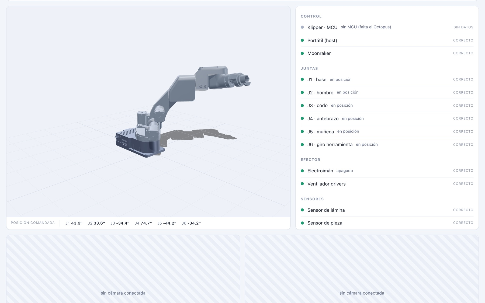
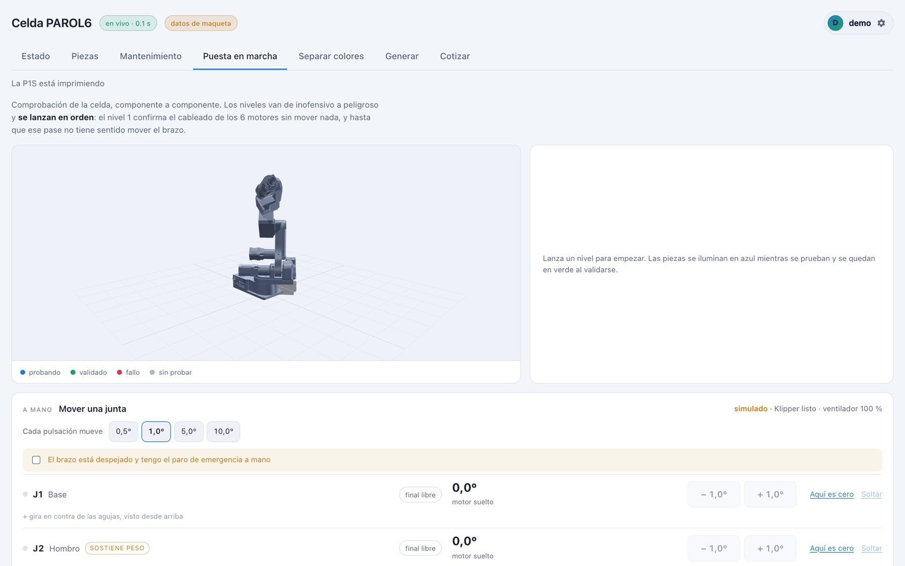
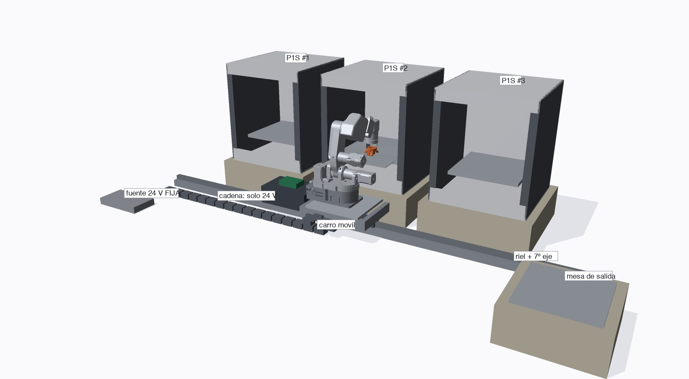
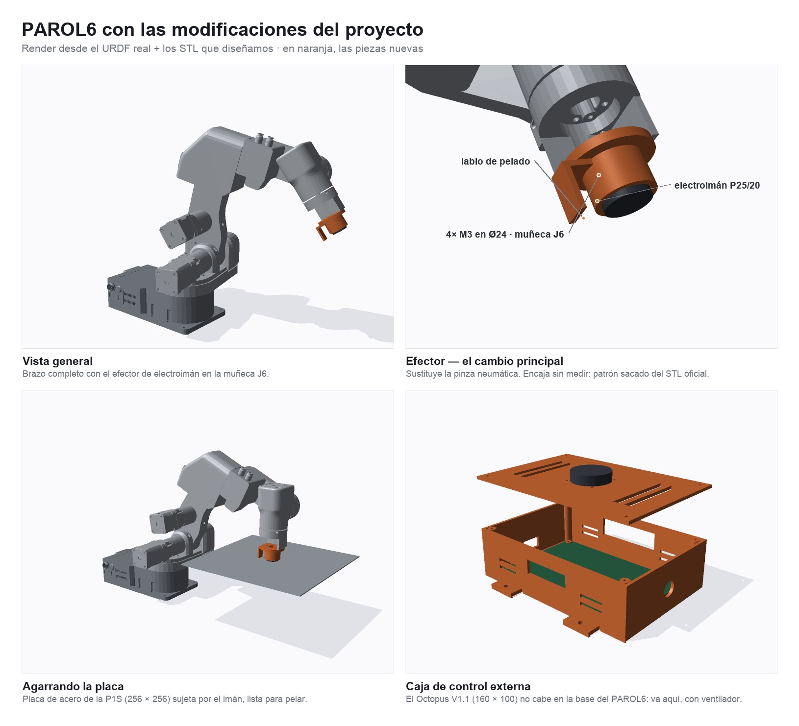
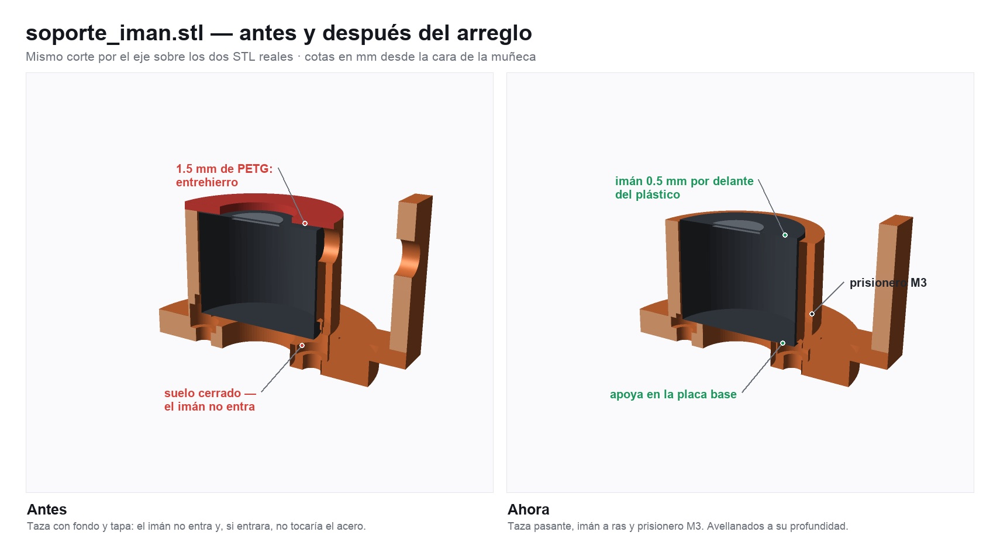
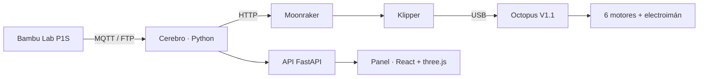

# 🤖 Celda PAROL6 — Impresión 3D continua y desatendida

**Un brazo robótico de 6 ejes que cambia la placa de la impresora y lanza el siguiente trabajo, solo**

[🌐 Ver portafolio](https://azixtechnologyco-rgb.github.io/#celda)

## El problema

Una impresora 3D se detiene cada vez que termina una pieza: alguien tiene que retirar la placa,
limpiarla y lanzar el siguiente trabajo. Eso impide producir de noche o en series largas.

## La solución

Una celda automática en la que un **brazo PAROL6 de 6 ejes** atiende a una impresora Bambu Lab P1S:

1. Detecta que la impresión terminó (MQTT).
2. Retira la placa de acero con la pieza usando un **electroimán** en el efector.
3. Coloca una placa limpia.
4. Lanza el siguiente trabajo de la cola.

Además:

- **Panel web en 3D** (three.js) con la posición de cada junta, sensores, cámaras y alertas.
- **Puesta en marcha guiada** por niveles de riesgo, junta por junta, con paro de emergencia.
- Mantenimiento por horas de máquina y kilos de filamento, y **cotizador** de piezas.
- **Piezas mecánicas propias** diseñadas por código, con chequeo de colisiones contra la impresora.
- Usuarios con roles, sesiones revocables y contraseñas con PBKDF2.

## Capturas

| Puesta en marcha | Disposición de la celda |
|---|---|
|  |  |
| **Piezas diseñadas** | **Efector, antes y después** |
|  |  |

## Arquitectura

**Stack:** Python · FastAPI · React + TypeScript · three.js · Vite · Klipper · Moonraker · MQTT · SQLite · CAD paramétrico · Linux

---

> 🔒 El código fuente es privado. Las capturas del panel muestran el **modo simulado**, sin hardware conectado.
>
> Desarrollado por **[Azix Technology](https://azixtechnologyco-rgb.github.io)** · Isaac Ávila
